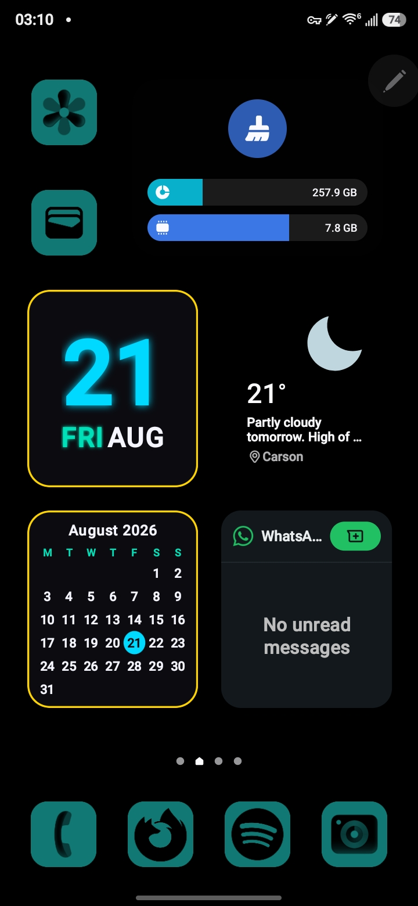
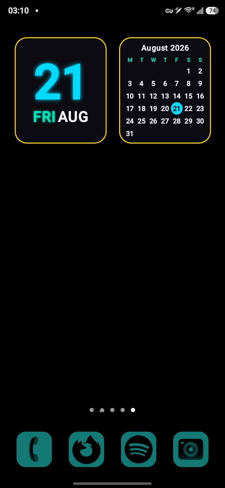

# Today Widget

Three iOS-style home-screen widgets for Android, plus a minimal app screen.

## Widgets

- **"Today Clock"** — a small square glance at today: weekday + month
  (e.g. "Fri Aug") with a big day-of-month number below (e.g. "21").
- **"Today Calendar"** — a full current-month calendar grid, today
  highlighted. There's no previous/next-month navigation — like iOS's
  equivalent, it always just shows "now."
- **"Today + Calendar"** (4×2) — the two merged side by side:
  - **Left:** today's day number (big, cyan, zero-padded) with the full
    weekday ("TUESDAY") underneath. Sizes match the Weather Donkey Wide
    widget so the two look like a set: the number is 60sp like its
    temperature, the weekday 14sp like its city name. Under that, a small dim
    "WEEK 47 · 44 LEFT" (ISO week number and days left in the year).
  - **Right:** the month grid, past a thin bright-teal divider (80% teal,
    same as the Weather Donkey Wide lines). Today is a filled
    cyan pill with a bold black number, and days already past are dimmed.
    Week rows the month doesn't use are hidden, so the rows that are used
    fill the height and the space above and below the grid stays even.

Each widget has its own distinct label (set via `android:label` on each
receiver in the manifest), so when you go to add a widget for this app, the
OS's own widget picker already shows them as clearly named, separately
previewed choices — "Today Clock", "Today Calendar" and "Today + Calendar" —
no custom in-app picker needed.

All three widgets:
- Refresh themselves automatically at midnight (and on manual clock/timezone
  changes), so they never freeze on a stale date — see `DateChangeReceiver.kt`.
- Open the phone's own default calendar app when tapped, the same way
  tapping iOS's Calendar widgets hands off to the Calendar app.
- Repaint right after the app is updated (`MY_PACKAGE_REPLACED`), so they
  never sit on their bare placeholder layout after a reinstall.

## Screenshots

<p>
  
  
</p>

## Theme

Pitch-black cards with a 2dp teal outline, matching the rest of the widget
family (Weather Donkey, Garage, SysMon). Weekday labels are teal, the month
label is white, and the day number / "today" highlight is cyan.

## Project layout

- `CalendarUtil.kt` — all the date/month math, shared by every widget.
- `DateWidgetProvider.kt` / `MonthWidgetProvider.kt` /
  `TodayCalendarWidgetProvider.kt` — each widget's brain.
  `MonthWidgetProvider.bindMonth()` fills the month grid for both the 2×2
  calendar and the 4×2 combined widget.
- `DateChangeReceiver.kt` — keeps every widget in sync with the real date
  (midnight, clock/timezone changes, app updates).
- `WidgetLaunch.kt` — builds the "open the default calendar app" tap intent.
- `MainActivity.kt` — the app icon's own simple "today" screen.

## Building

```
export JAVA_HOME=/path/to/jdk17
./gradlew assembleDebug
```

Requires a `local.properties` file (not checked in) pointing `sdk.dir` at
your Android SDK.
